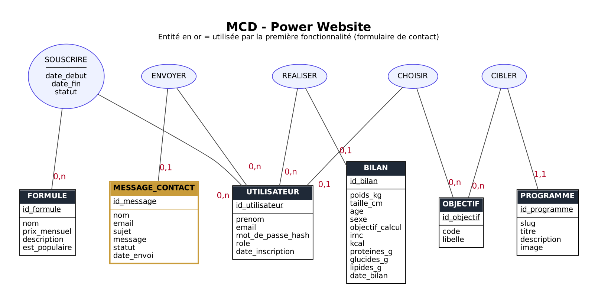
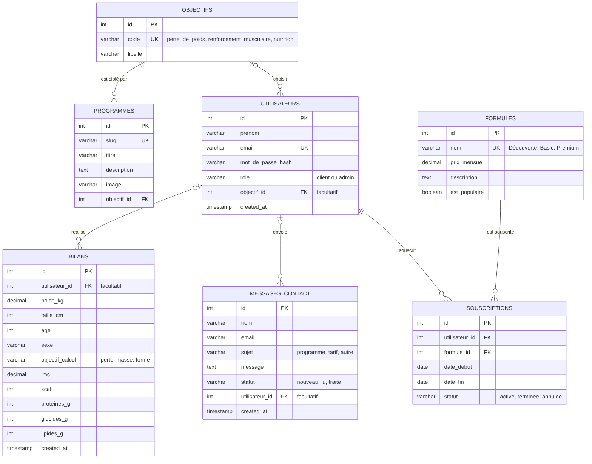

# 2. Conception de la base de données

Le schéma est présenté sous trois formes : le **MCD** (modèle conceptuel), le **MLD** (modèle logique, c'est-à-dire les tables) et le **script SQL** correspondant.

## MCD (Modèle Conceptuel de Données)



Fichiers sources : [`schemas/mcd.dot`](schemas/mcd.dot) (Graphviz) et version vectorielle [`schemas/mcd.svg`](schemas/mcd.svg).
L'entité en or, `MESSAGE_CONTACT`, est la seule utilisée par la première fonctionnalité.

### Lecture des cardinalités

Une cardinalité `(min,max)` se lit du côté de l'entité : combien de fois elle peut participer à l'association.

| Association | Lecture |
|---|---|
| **CHOISIR** : UTILISATEUR (0,1) — OBJECTIF (0,n) | Un utilisateur choisit au plus un objectif (il peut ne pas en avoir choisi). Un objectif peut être choisi par 0 à plusieurs utilisateurs. |
| **CIBLER** : PROGRAMME (1,1) — OBJECTIF (0,n) | Un programme vise exactement un objectif. Un objectif peut avoir 0 à plusieurs programmes. |
| **SOUSCRIRE** : UTILISATEUR (0,n) — FORMULE (0,n) | Un utilisateur peut souscrire plusieurs formules (au fil du temps), et une formule peut être souscrite par plusieurs utilisateurs. L'association porte ses propres données : `date_debut`, `date_fin`, `statut`. |
| **ENVOYER** : MESSAGE_CONTACT (0,1) — UTILISATEUR (0,n) | Un message est envoyé par au plus un utilisateur : le (0,1) permet à un visiteur non connecté d'écrire. Un utilisateur peut envoyer 0 à plusieurs messages. |
| **REALISER** : BILAN (0,1) — UTILISATEUR (0,n) | Un bilan du calculateur appartient à au plus un utilisateur (un visiteur anonyme peut aussi l'utiliser). |

## MLD (Modèle Logique de Données)



Fichiers sources : [`schemas/mld.mmd`](schemas/mld.mmd) (Mermaid) et [`schemas/mld.svg`](schemas/mld.svg).

### Passage du MCD au MLD

- Chaque **entité** devient une **table**, et son identifiant devient la **clé primaire** (PK).
- Une association **(0,1) ou (1,1) — (0,n)** devient une **clé étrangère** (FK) placée du côté « 1 » : `utilisateurs.objectif_id`, `programmes.objectif_id`, `messages_contact.utilisateur_id`, `bilans.utilisateur_id`. Elle est facultative (`NULL` autorisé) quand la cardinalité est (0,1), et obligatoire quand elle est (1,1).
- Une association **(0,n) — (0,n)** devient une **table à part** contenant les deux clés étrangères et les attributs de l'association : c'est la table `souscriptions`.

### Représentation textuelle du MLD

```
objectifs        (id, code, libelle)
utilisateurs     (id, prenom, email, mot_de_passe_hash, role, #objectif_id, created_at)
programmes       (id, slug, titre, description, image, #objectif_id)
formules         (id, nom, prix_mensuel, description, est_populaire)
souscriptions    (id, #utilisateur_id, #formule_id, date_debut, date_fin, statut)
messages_contact (id, nom, email, sujet, message, statut, #utilisateur_id, created_at)
bilans           (id, #utilisateur_id, poids_kg, taille_cm, age, sexe, objectif_calcul,
                  imc, kcal, proteines_g, glucides_g, lipides_g, created_at)
```
Notation : dans chaque table, `id` est la clé primaire, et `#` marque une clé étrangère.

## Dictionnaire de données

### `messages_contact` (première fonctionnalité)

| Champ | Type | Contraintes | Description |
|---|---|---|---|
| `id` | entier | clé primaire, auto-incrémenté | Identifiant du message |
| `nom` | texte (50) | obligatoire | Nom saisi (2 à 50 lettres) |
| `email` | texte (254) | obligatoire | Adresse de réponse, enregistrée en minuscules |
| `sujet` | texte (20) | `programme`, `tarif` ou `autre` (défaut) | Sujet choisi dans la liste |
| `message` | texte (1000) | obligatoire, 10 à 1000 caractères | Contenu du message |
| `statut` | texte (20) | `nouveau` (défaut), `lu`, `traite` | Suivi du traitement |
| `utilisateur_id` | entier | clé étrangère vers `utilisateurs`, facultatif | Auteur s'il était connecté |
| `created_at` | date et heure | défaut : maintenant | Date de réception |

### `objectifs`

| Champ | Type | Contraintes | Description |
|---|---|---|---|
| `id` | entier | PK | |
| `code` | texte (50) | unique | `perte_de_poids`, `renforcement_musculaire`, `nutrition` |
| `libelle` | texte (100) | obligatoire | Libellé affiché |

### `utilisateurs`

| Champ | Type | Contraintes | Description |
|---|---|---|---|
| `id` | entier | PK | |
| `prenom` | texte (50) | obligatoire | |
| `email` | texte (254) | unique, obligatoire | Identifiant de connexion |
| `mot_de_passe_hash` | texte (255) | obligatoire | Mot de passe **haché** : on ne stocke jamais le mot de passe lui-même |
| `role` | texte (20) | `client` (défaut) ou `admin` | |
| `objectif_id` | entier | FK vers `objectifs`, facultatif | Objectif choisi dans le quiz |
| `created_at` | date et heure | défaut : maintenant | |

### `programmes`

| Champ | Type | Contraintes | Description |
|---|---|---|---|
| `id` | entier | PK | |
| `slug` | texte (80) | unique | Identifiant d'URL (`prise-de-masse`), utilisé comme ancre |
| `titre` | texte (120) | obligatoire | |
| `description` | texte | obligatoire | |
| `image` | texte (255) | obligatoire | Nom du fichier image |
| `objectif_id` | entier | FK vers `objectifs`, obligatoire | Objectif visé |

### `formules`

| Champ | Type | Contraintes | Description |
|---|---|---|---|
| `id` | entier | PK | |
| `nom` | texte (50) | unique | Découverte, Basic, Premium |
| `prix_mensuel` | décimal (6,2) | ≥ 0 | 0,00 / 9,90 / 19,90 |
| `description` | texte | facultatif | |
| `est_populaire` | booléen | défaut : faux | Affiche le bandeau « Le plus populaire » |

### `souscriptions`

| Champ | Type | Contraintes | Description |
|---|---|---|---|
| `id` | entier | PK | |
| `utilisateur_id` | entier | FK vers `utilisateurs`, obligatoire, suppression en cascade | |
| `formule_id` | entier | FK vers `formules`, obligatoire | |
| `date_debut` | date | obligatoire | |
| `date_fin` | date | facultative, doit être ≥ `date_debut` | |
| `statut` | texte (20) | `active` (défaut), `terminee`, `annulee` | |

### `bilans`

| Champ | Type | Contraintes | Description |
|---|---|---|---|
| `id` | entier | PK | |
| `utilisateur_id` | entier | FK vers `utilisateurs`, facultatif | |
| `poids_kg` | décimal (4,1) | entre 30 et 250 | Mêmes bornes que le formulaire |
| `taille_cm` | entier | entre 120 et 230 | |
| `age` | entier | entre 15 et 99 | |
| `sexe` | texte (10) | `femme` ou `homme` | |
| `objectif_calcul` | texte (10) | `perte`, `masse` ou `forme` | Objectif choisi dans le calculateur |
| `imc`, `kcal`, `proteines_g`, `glucides_g`, `lipides_g` | décimal / entiers | obligatoires | Résultats du calcul |
| `created_at` | date et heure | défaut : maintenant | |

## Script SQL

- [`../backend/database/schema.sql`](../backend/database/schema.sql) : création des 7 tables, contraintes et index.
- [`../backend/database/seed.sql`](../backend/database/seed.sql) : données initiales (3 objectifs, 3 formules, 3 programmes), reprises du contenu actuel du site.

Le script est écrit pour PostgreSQL. Pour MySQL/MariaDB, remplacer `INTEGER GENERATED ALWAYS AS IDENTITY PRIMARY KEY` par `INTEGER AUTO_INCREMENT PRIMARY KEY`.
Il a été exécuté dans SQLite (en adaptant seulement la ligne d'identifiant) pour vérifier que les tables se créent et que les contraintes refusent bien les données invalides (sujet inconnu, e-mail en double, objectif inexistant, dates incohérentes…). Il n'a pas été testé sur PostgreSQL ni MySQL.

## Choix de conception

- **Un visiteur non connecté peut écrire** : `messages_contact.utilisateur_id` est facultatif. Le formulaire de contact fonctionne sans compte.
- **Les règles du formulaire sont aussi dans la base** : les `CHECK` (sujet, statut, bornes du calculateur) reprennent les règles déjà appliquées par le navigateur et par l'API. Une règle protégée à trois niveaux ne dépend plus d'un seul.
- **Mot de passe haché** : jamais de mot de passe en clair dans la base.
- **Formules et programmes en tables** : les prix et les textes cessent d'être écrits en dur dans le HTML et deviennent modifiables.
- **Cohérence avec le code** : l'objet enregistré par `contact.model.js` a exactement les champs de `messages_contact`.
