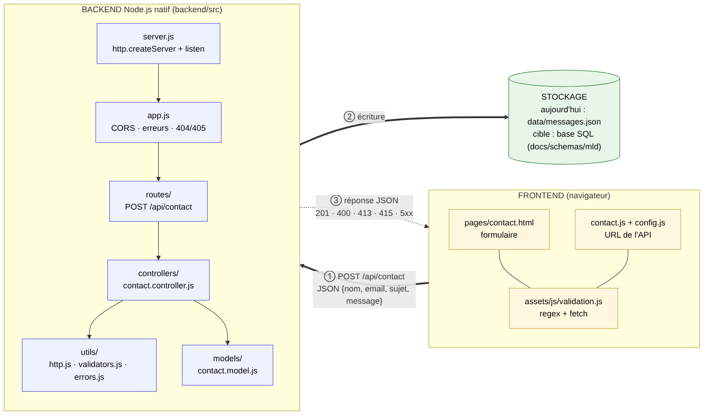
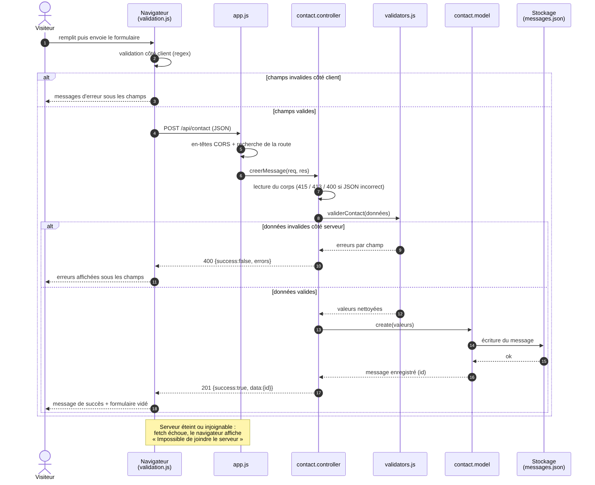

# 3. Schéma fonctionnel et structure du backend

## Vue d'ensemble



Sources : [`schemas/architecture.mmd`](schemas/architecture.mmd) (Mermaid) et [`schemas/architecture.svg`](schemas/architecture.svg).

Le navigateur (frontend) envoie une requête HTTP au serveur Node.js (backend). Le serveur vérifie les données, les confie au modèle qui les enregistre, puis renvoie une réponse JSON que le navigateur affiche. Les trois échanges numérotés sur le schéma :

1. **Frontend → backend** : `POST /api/contact` avec les données du formulaire en JSON, envoyé par `fetch`.
2. **Backend → stockage** : le modèle enregistre le message. Aujourd'hui, dans le fichier `backend/data/messages.json` ; ensuite, dans la base SQL décrite dans [`02-base-de-donnees.md`](02-base-de-donnees.md).
3. **Backend → frontend** : une réponse JSON avec un code HTTP (201 si tout va bien, 400 si les données sont invalides…).

## Déroulement détaillé d'un envoi de message



Sources : [`schemas/sequence-contact.mmd`](schemas/sequence-contact.mmd) et [`schemas/sequence-contact.svg`](schemas/sequence-contact.svg).

## Structure des dossiers

```
backend/
├── package.json              scripts npm (start, dev, test), aucune dépendance
├── .gitignore                ignore node_modules et les fichiers de données
├── database/
│   ├── schema.sql            création des tables (traduction du MLD)
│   └── seed.sql              données initiales
├── data/                     messages.json est créé ici automatiquement (ignoré par Git)
├── src/
│   ├── server.js             point d'entrée : démarre le serveur
│   ├── app.js                traite chaque requête : CORS, routage, erreurs
│   ├── config.js             réglages (port, CORS, fichier de données)
│   ├── routes/
│   │   ├── index.js          regroupe les routes et trouve celle d'une requête
│   │   ├── contact.routes.js POST /api/contact
│   │   └── health.routes.js  GET  /api/health
│   ├── controllers/
│   │   ├── contact.controller.js   logique du formulaire de contact
│   │   └── health.controller.js
│   ├── models/
│   │   └── contact.model.js  enregistrement des messages
│   └── utils/
│       ├── http.js           répondre en JSON, lire le corps d'une requête
│       ├── validators.js     règles de validation (nom, email, message, sujet)
│       └── errors.js         erreur portant un code HTTP
└── tests/
    ├── validators.test.js    tests unitaires de la validation
    └── contact.api.test.js   tests de l'API avec un vrai serveur
```

## Rôle de chaque couche

| Couche | Fichier(s) | Responsabilité | Ne doit PAS |
|---|---|---|---|
| Démarrage | `server.js` | Créer le serveur et l'écouter sur un port | Contenir de la logique métier |
| Cœur HTTP | `app.js` | En-têtes CORS, trouver la route, transformer les erreurs en réponses | Connaître les règles du contact |
| Routes | `routes/*.js` | Associer « méthode + chemin » à un contrôleur | Contenir de la logique |
| Contrôleurs | `controllers/*.js` | Orchestrer : lire la requête, valider, appeler le modèle, répondre | Écrire dans un fichier ou une base |
| Modèles | `models/*.js` | Lire et écrire les données | Connaître HTTP (requête, réponse) |
| Utilitaires | `utils/*.js` | Petites fonctions réutilisables et faciles à tester | Dépendre d'une fonctionnalité précise |

Cette séparation a un intérêt concret : quand la base de données sera branchée, **seul le modèle changera**. Le contrôleur, les routes et les tests resteront les mêmes.

## Ce que Node.js natif oblige à faire à la main

Avec un framework comme Express, plusieurs choses sont fournies toutes faites. Avec le module `http` seul, elles sont écrites dans le projet :

| Besoin | Où c'est fait |
|---|---|
| Choisir le code selon la méthode et l'adresse (routage) | `routes/index.js` (`trouverRoute`) |
| Lire le corps d'une requête et le transformer en objet | `utils/http.js` (`readJsonBody`) |
| Refuser les corps trop gros ou mal formés | `utils/http.js` |
| Répondre en JSON avec le bon code | `utils/http.js` (`sendJson`) |
| Autoriser le site à appeler l'API depuis une autre adresse (CORS) | `app.js` (`ajouterEntetes`, réponse à `OPTIONS`) |
| Gérer proprement les erreurs (404, 405, 500) | `app.js` (`repondreErreur`) |

## Ajouter une fonctionnalité

Le même schéma sert pour les prochaines fonctionnalités (inscription, connexion…) :

1. Ajouter les règles de validation dans `utils/validators.js`.
2. Créer `models/xxx.model.js` pour les données.
3. Créer `controllers/xxx.controller.js` qui orchestre.
4. Créer `routes/xxx.routes.js` et l'ajouter à la liste dans `routes/index.js`.
5. Écrire les tests dans `tests/`.
